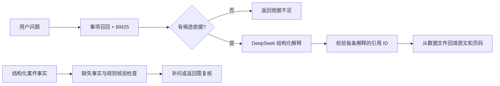

# 湖北交通运输法规与裁量助手

围绕湖北交通运输行政执法学习 RAG 和智能体开发的 Python 项目。第一版覆盖普通公路“擅自占用、挖掘公路”：输入行为描述，检索上传资料，返回原文、页码和待核实问题；配置 DeepSeek 后可生成带引用的解释。

当前技术栈：**Python 3.11+（本地验证为 3.12）＋ FastAPI ＋ HTTPX/DeepSeek ＋ JSONL ＋ 本地 BM25**。检索、数据、模型调用和规则检查分层，后续可以接入 Embedding、Qdrant 和 AgentScope。

## 当前能做什么

| 能力 | 当前实现 |
| --- | --- |
| 法规资料 | 从用户上传的 215 页 PDF 中转录第 2 页第 3 项，含 4 条认定/处罚依据节选和 1 条完整三档裁量记录 |
| 独立检索 | 中文词项、BM25、事项口语别名、条号优先匹配；保留同事项关联依据 |
| RAG 问答 | 检索 → DeepSeek JSON 回复 → 引用 ID 校验 → 后端回填原文和出处 |
| 模型错误处理 | 缺 Key、认证失败、余额不足、限流、网络失败、总超时、空回复、截断、非法 JSON |
| 裁量辅助 | 结构化事实输入、缺失字段追问、地域/道路类型检查、边界复核提醒 |
| 数据整理 | PDF 逐页提取到待整理区，原文件 SHA-256、页码、版本和核验状态 |
| 使用入口 | 命令行、HTTP API、可操作的 `/docs` 页面 |
| 回归评测 | 离线测试和 20 条检索开发回归题 |

**资料效力和个案适用尚未核验，裁量规则为草稿。**当前规则模块不自动匹配罚款档次、不计算具体罚款；RAG 提示词也要求只解释材料。引用 ID 校验只能保证来源来自本次检索，不能证明模型的每一句解释都得到原文充分支持。

## 1. 安装与离线体验

在项目根目录运行（macOS / Linux）：

```bash
python3 -m venv .venv
source .venv/bin/activate
python -m pip install -e ".[dev,pdf]" -c constraints.txt

python -m transport_law validate-data
python -m transport_law retrieve "在公路上挖沟，需要查哪些依据？"
python -m transport_law retrieve "超速多少罚款？"
python -m transport_law check-facts evals/case_missing_facts.json
```

第一条检索应返回 5 条依据；“超速”应返回空 `hits`。事实检查示例会返回缺失字段和边界复核提醒。以上命令全部离线，不需要 API Key。

Windows PowerShell 的前两步改为：

```powershell
py -3.12 -m venv .venv
.\.venv\Scripts\Activate.ps1
```

本地已经创建了 `.venv` 时，只需激活后继续使用。PyCharm 中选择项目目录下的 `.venv/bin/python`（Windows 为 `.venv\Scripts\python.exe`）作为解释器。运行配置可使用模块 `transport_law`，参数 `serve --reload`，工作目录为项目根目录。

`constraints.txt` 记录本次验证的依赖版本。这里只支持在源码仓库中以 editable 方式安装，运行依赖项目的 `data/` 目录；尚未制作包含数据的独立分发包。

## 2. 接入 DeepSeek

首次使用时复制 `.env.example` 为 `.env`；如果 `.env` 已存在，直接编辑它，不覆盖已有配置。本次搭建已创建空 Key 的本地 `.env`。

```dotenv
DEEPSEEK_API_KEY=在本地填写你的真实Key
DEEPSEEK_BASE_URL=https://api.deepseek.com
DEEPSEEK_MODEL=deepseek-flash
```

密钥只放本地，`.gitignore` 已忽略 `.env`。修改 `.env` 后需要重启已运行的服务。配置模型后分别验证两个层次：

```bash
# 只检查模型连接
python -m transport_law chat "请用一句话解释 RAG。"

# 检索 + 模型解释 + 引用校验
python -m transport_law ask "没办手续就在公路上挖沟，材料里有哪些依据，需要补充什么信息？"
```

`chat` 和命中资料后的 `ask` 会向配置的 DeepSeek 服务发送输入，并使用 API 额度；RAG 同时发送本次检索到的资料。没有命中资料时直接返回 `insufficient_evidence`，不调用模型。本次搭建没有配置真实 Key，也没有发送真实模型请求。

模型接口和默认名称依据 2026-11-02 查阅的 [DeepSeek Chat Completions 文档](https://api-docs.deepseek.com/api/create-chat-completion/)；JSON 参数和空白回复处理依据 [DeepSeek JSON Output 文档](https://api-docs.deepseek.com/guides/json_mode/)。代码直接用 HTTPX 调用 DeepSeek，不需要 OpenAI 账户。初版显式关闭 thinking，所有输出仍做本地结构校验。

成功问答中的关键字段：

| 字段 | 含义 |
| --- | --- |
| `answer` | 各条解释拼成的正文 |
| `claims[].citation_ids` | 每条解释与依据条目的对应关系 |
| `sources` | 后端回填的真实条目，含 `text`、版本、来源文件及 `pdf_page` |
| `follow_up_questions` | 模型提出的补充问题 |
| `applicability_status` | 当前固定为 `not_verified` |
| `model` / `usage` | 实际响应的模型名称和可用的 token 用量 |

## 3. 启动接口

```bash
python -m transport_law serve --reload
```

打开 [接口文档](http://127.0.0.1:8000/docs)，选择接口 → **Try it out** → 输入 JSON → **Execute**。

| 接口 | 用途 | 需要 Key |
| --- | --- | --- |
| `GET /health` | 数据数量和本地配置状态 | 否 |
| `POST /api/v1/retrieve` | 原文检索 | 否 |
| `GET /api/v1/articles/{chunk_id}` | 读取一条完整记录 | 否 |
| `POST /api/v1/ask` | 带引用解释 | 命中资料时需要 |
| `GET /api/v1/discretion/{item_id}` | 查看裁量规则草稿 | 否 |
| `POST /api/v1/discretion/check` | 缺失事实和复核事项检查 | 否 |

检索/问答输入示例：

```json
{"question": "在路边挖了条沟，相关材料如何规定？", "top_k": 5}
```

裁量事实输入示例：

```json
{
  "item_id": "road_occupation_excavation",
  "region": "湖北省",
  "location": "待核实的市县和路段",
  "occurred_on": "2026-10-01",
  "road_type": "ordinary_highway",
  "behavior": "excavation",
  "has_permission": false,
  "area_m2": "20",
  "facts_verified": false
}
```

不知道的字段可以省略，不应猜测。`false` 表示明确陈述没有许可，与未填写不同。即使字段填齐，草稿规则仍返回 `needs_review`。`facts_verified` 仅为调用方声明，没有身份或审批效力。

`/health` 的 `llm_configured` 只表示 Key 非空，连通性用 `chat` 检查。服务默认监听 `127.0.0.1`，适合本机开发；当前没有用户鉴权和多用户隔离，尚未部署为公共服务。

## 4. 理解目录和流程

```text
src/transport_law/
  config.py        .env 与路径配置
  schemas.py       条目、来源、问答、案件事实的数据结构
  repository.py    JSONL 加载、校验、按 ID 读取原文
  retrieval.py     事项召回与 BM25 排序（不调用模型）
  llm.py           DeepSeek HTTP 请求、超时和错误处理
  prompts.py       有证据的解释提示词
  service.py       RAG 流程与引用校验
  discretion.py    裁量事实检查和草稿规则读取
  ingest.py        PDF 逐页提取
  evaluation.py    检索回归评测
  runtime.py       组装各模块
  main.py          FastAPI 接口
  cli.py           命令行入口
data/
  raw/             原始 PDF 和来源清单
  processed/       已整理的知识片段
  rules/           待核验的裁量规则
  staging/         提取结果，默认不提交 Git
evals/             检索题集、事实输入示例
tests/             离线回归测试
docs/              架构、数据整理和后续计划
```



建议阅读顺序：`schemas.py` → `repository.py` → `retrieval.py` → `llm.py` → `service.py` → `main.py`。详细设计见 [架构说明](docs/architecture.md)。

## 5. 加入更多资料与验证

```bash
python -m transport_law extract-pdf data/raw/P020250918567517504506.pdf \
  --output data/staging/pages.jsonl

python -m transport_law validate-data
python -m transport_law evaluate
python -m pytest -q
python -m ruff check src tests
python -m ruff format --check src tests
```

PDF 提取只生成待整理文本，不自动成为法规条目；重复输出路径会报错，以免覆盖。表格合并单元格和跨页关系需对照原 PDF 整理，步骤见 [数据整理说明](docs/data-guide.md)。修改资料后重启服务加载新版本。

20 题是单事项开发回归集，正例主要验证关联依据可召回，不能表示真实场景准确率；一条正例的前 5 条可能正好包含全部首批语料。条号排序、错误引用、模型错误和事实边界另有单元测试。验证结果见 [验证记录](docs/validation.md)。

后续按 [开发路线](docs/roadmap.md) 依次推进完整法源核验、裁量规则、混合检索、会话状态和 AgentScope；当前没有对话记忆、自动法规更新或图像巡检。
