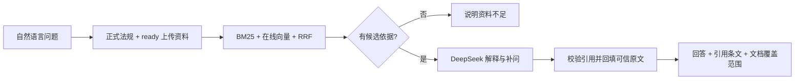

# 湖北交通运输法规与裁量助手

用自己的话描述交通法规问题，在线获得带出处的解释、需要补充的信息，并查看引用条文和已收录法规原文。法规查找、带依据问答和裁量参考共用一个入口，不需要先选择功能或填写案件事实表单。

业务问答固定使用 **BM25 + 阿里云百炼向量检索 + RRF 融合 + DeepSeek**。正式法规与已完成入库的上传资料共同参与检索；BM25 与向量检索共用通用的法规名称、条号和 ID 定位，不再为某个事项补入固定关联条文。算法比较供维护使用，不提供独立的离线问答或离线检索入口。资料目录见 [湖北交通法律法规资料库](docs/legal-sources.md)。

当前技术栈为 Python 3.11+、FastAPI、HTTPX、LangChain Core / Text Splitters、JSONL 和 ChromaDB。前端使用原生 HTML / CSS / JavaScript，由同一个 Python 服务提供。

## 1. 安装和配置

在项目根目录运行（macOS / Linux）：

```bash
python3 -m venv .venv
source .venv/bin/activate
python -m pip install -e ".[dev,ingest,vectors]" -c constraints.txt
```

Windows PowerShell 的前两步改为：

```powershell
py -3.12 -m venv .venv
.\.venv\Scripts\Activate.ps1
```

首次使用时复制 `.env.example` 为 `.env`；已有 `.env` 时直接编辑，不覆盖原配置。在线问答需要分别配置百炼和 DeepSeek 的密钥：

```dotenv
DASHSCOPE_API_KEY=在本地填写百炼密钥
DEEPSEEK_API_KEY=在本地填写DeepSeek密钥
```

完整的地址、模型和超时配置见 [.env.example](.env.example)。真实密钥只放本地 `.env`，该文件已被 Git 忽略；修改配置后重启服务。前端不会收到模型密钥。

普通自然语言问答会把问题发往百炼生成查询向量，再将问题与本次检索原文发送给 DeepSeek；精确条目 ID 可跳过问题向量生成，但仍需两种密钥配置并调用 DeepSeek。这些请求会使用对应服务的额度。缺少配置、索引不可用或在线调用失败时会明确报错，不退回离线问答。没有检索到依据时返回资料不足，不调用回答模型。

`constraints.txt` 记录验证过的依赖版本。当前以源码仓库的 editable 安装方式运行，依赖项目内的 `data/` 目录；尚未提供包含法规数据的独立分发包。PyCharm 解释器可选择 `.venv/bin/python`，模块为 `transport_law`，启动参数为 `serve --reload`，工作目录设为项目根目录。

## 2. 准备法规向量索引

已有可用索引时不必重复入库。首次部署或整理后的资料发生变化时，先生成包含父条目出处的分块，再预检和入库：

```bash
python scripts/chunk_legal_corpus.py --output-dir data/staging/current_document_batch
python -m transport_law index-vectors \
  --documents data/staging/current_document_batch/langchain_documents.jsonl --dry-run
python -m transport_law index-vectors \
  --documents data/staging/current_document_batch/langchain_documents.jsonl
python -m transport_law vector-status
```

`--dry-run` 只检查输入，不写数据库或调用在线模型。正式入库调用百炼，支持分批处理、重复跳过和断点续传。数据库默认位于 Git 忽略的 `data/local/chroma/`。启动服务不会重新分块或生成已有文档的向量；语义查询只生成问题向量，精确 ID 定位可跳过该步骤。

索引维护和模型更换见 [向量检索说明](docs/vector-retrieval.md)。该文档中的历史算法对比用于维护评估；当前用户问答固定使用 hybrid。

## 3. 直接提问

```bash
python -m transport_law serve --reload
```

打开 [问答页面](http://127.0.0.1:8000/)，直接输入，例如：

> 在湖北一段普通公路上，施工队没办许可就挖沟埋管。这种情况该怎么处理，有什么依据？

页面只有一个问题输入区，支持示例填入和 `Ctrl / ⌘ + Enter` 发送。回答会列出引用依据；点击引用编号可查看条文详情，引用卡展示原文、官方链接或 PDF 页码。“查看已收录原文”打开同一文档、同一版本的收录内容。

需要补充资料时，点击顶部“上传资料”或输入框旁的“补充自己的资料”。选择或拖入一份 PDF、TXT、Markdown，点击“上传并入库”。页面展示等待、入库中、已入库或失败状态；未完成任务会自动更新进度，失败时可查看原因并重试。只有“已入库”的文档会参与下一次统一问答；可点击“查看入库原文”核对内容，或“去问答”返回提问。文件大小上限读取当前服务配置；同名文件不会覆盖，上传记录在刷新后仍保留。

每次提问独立处理，没有多轮记忆。回答要求补充情况时，请在原问题里保留背景、添加新信息后再次发送。输入和结果只保留在当前页面，刷新即清除。请求期间可以取消等待；这不保证已发送的上游请求停止执行或计费。

命令行使用同一条在线问答链：

```bash
python -m transport_law ask "根据公路法第四十四条，占用、挖掘公路需要履行哪些手续？"
```

面向使用者的 CLI 入口为 `ask` 和 `serve`。算法比较、资料校验和入库命令供维护使用。

### 看清资料收录范围

“引用条文原文”与“整部法规全文”是不同范围。文档接口明确返回以下覆盖类型，页面按实际类型显示：

| `coverage` | 表示的范围 |
| --- | --- |
| `full_text` | 已收录该版本的整部法规正文 |
| `selected_sections` | 仅收录选定章节或部分材料，例如裁量总则及交通管理册 |
| `excerpts` | 仅收录节选条目 |
| `uploaded_document` | 已处理的上传文档内容，不据此宣称是完整或有效法规 |

`coverage_note` 解释具体收录边界；无法确认全文时不能标为 `full_text`。全文收录也不等于已确认现行有效或适用于个案。原始来源、版本、转录核对和效力核验应分别检查。

## 4. API 与上传资料管理

开发调试可打开 [接口文档](http://127.0.0.1:8000/docs)。业务提问只使用 `POST /api/v1/ask`；前端不暴露检索数量、后端算法或模型参数。

| 接口 | 用途 |
| --- | --- |
| `POST /api/v1/ask` | 在线检索、回答、补问及引用；需要百炼和 DeepSeek 配置 |
| `GET /api/v1/articles/{chunk_id}` | 读取正式法规或上传资料中的引用原文与来源 |
| `GET /api/v1/documents/{document_id}?version_id=...` | 读取指定版本的全部已收录内容及覆盖范围 |
| `GET /health` | 查看服务、数据和配置状态，不调用模型 |
| `POST /api/v1/knowledge/documents` | 上传 PDF/TXT/Markdown，后台切分并写入上传库 |
| `GET /api/v1/knowledge/documents` | 上传资料列表 |
| `GET /api/v1/knowledge/documents/{id}` | 处理进度或错误 |
| `POST /api/v1/knowledge/documents/{id}/retry` | 继续失败或中断的入库任务 |

问答请求示例：

```json
{"question": "在湖北普通公路上未经许可挖沟，需要核实什么，有哪些依据？"}
```

| 问答响应字段 | 含义 |
| --- | --- |
| `status` / `answer` | 回答或资料不足状态，以及解释正文 |
| `claims[].text` / `citation_ids` | 每条解释及其引用条目 ID |
| `sources` | 回答实际引用的真实原文、版本与出处 |
| `source_documents` | 全部本次检索原文，包含未被回答引用的候选 |
| `follow_up_questions` | 需要补充或核实的信息 |
| `notice` / `applicability_status` | 使用边界；个案适用固定为 `not_verified` |
| `model` / `usage` | 实际响应的模型名称和可用的 Token 用量 |

文档响应包含 `document_id`、`version_id`、`title`、`coverage`、`coverage_note` 和 `articles`。全文展示使用保存的全部对应条目，不让模型生成或补写法规正文。PDF 来源保留真实 `pdf_page`，官网正文使用 `official_url` 与 `locator`，不为网页编造页码。

上传接口字段名为 `file`，支持 `.pdf`、`.txt`、`.md`、`.markdown`，默认最大 20 MiB。同名文件返回 `409`，接受任务后返回 `202`；状态为 `ready` 的资料才参与统一问答。上传库使用独立 collection，不重新生成已有正式法规向量，来源仍保留待核验标记。管理和持久化细节见 [上传知识库说明](docs/knowledge-upload.md)；提问统一使用本节的 `/api/v1/ask`。

`/health` 中密钥“已配置”只表示配置存在，不能证明模型实际连通。服务默认监听 `127.0.0.1`，当前没有用户鉴权和多用户隔离，适合本机使用。

## 5. 开发与维护

```text
src/transport_law/
  config.py        配置与路径
  schemas.py       条目、来源和问答的数据结构
  documents.py     文档模型、按版本读取与收录覆盖校验
  repository.py    正式条目校验、双库资料读取与原文回查
  retrieval.py     BM25、法规名称与条号约束
  embeddings.py    百炼向量接口、校验与重试
  vector_store.py  Chroma 持久化、续传与父法条回填
  hybrid.py        统一混合检索：全局 BM25 / 向量排名与 RRF 融合
  knowledge.py     上传登记、后台分块入库与上传资料检索
  llm.py           DeepSeek 请求、超时和错误处理
  prompts.py       提示词与原文消息构建
  service.py       在线配置检查、问答、引用校验与原文回填
  runtime.py       装配在线问答和维护所需组件
  main.py          API 与前端静态资源
  web/             单页问答，无前端构建依赖
  cli.py           ask / serve 及维护命令
data/
  raw/             来源 PDF、官网快照与来源清单
  processed/       整理后的知识条目
  staging/         分块等暂存产物，不提交 Git
  local/           本地索引、上传原件与处理记录，不提交 Git
evals/             检索回归题集
tests/             单元与接口回归测试
docs/              架构、来源、数据维护与验证记录
```



维护命令保留资料整理、校验、索引和回归评测。算法比较通过 `evaluate --backend` 进行，不改变在线问答的固定链路：

```bash
python -m transport_law validate-data
python -m transport_law evaluate --backend bm25
python -m transport_law evaluate --backend chroma --dataset evals/official_retrieval.jsonl
python -m transport_law evaluate --backend hybrid --dataset evals/traffic_police_retrieval.jsonl
python scripts/build_legal_corpus.py --check
python -m pytest -q
python -m ruff check src tests
python -m ruff format --check src tests
node --check src/transport_law/web/app.js
```

Chroma 和 hybrid 评测会调用百炼；BM25 评测及使用替身的测试可以在本地进行。这些维护检查不能替代真实在线模型链路验证，也不代表法律问答准确率或个案适用已经核准。

人工资料整理使用 `extract-pdf`、`chunk-document` 和 `scripts/chunk_legal_corpus.py`；上传 API 则负责自动追加入库。单独生成的 `DraftChunk` 是待审核草稿，不会因文件存在或服务重启自动进入正式法规库。扫描件需先 OCR，裁量表需核对列关系、档次和跨页内容。具体步骤见 [数据整理说明](docs/data-guide.md) 和 [自动分块说明](docs/chunking.md)。

**资料效力与个案适用尚需核验。**助手可解释材料和提示缺失事实，不自动认定用户未提供的事实、不自动选定处罚档次或计算确定罚款。引用校验确认出处属于本次检索，不保证模型解释得到原文充分支持。

设计与维护文档：

- [架构与数据边界](docs/architecture.md)、[在线问答链](docs/qa-chain.md)、[混合检索](docs/hybrid-retrieval.md)
- [资料来源与整理](docs/data-guide.md)、[分块工具](docs/chunking.md)、[向量索引](docs/vector-retrieval.md)、[上传管理](docs/knowledge-upload.md)
- [统一问答与上传验收记录](docs/unified-validation.md)、[早期数据与索引验证记录](docs/validation.md)

验证记录描述对应版本当时的检查结果；代码或候选范围改变后，应重新运行检查，不能直接沿用历史通过率。
