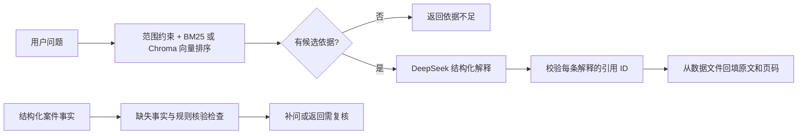

# 湖北交通运输法规与裁量助手

围绕湖北交通执法学习 RAG 和智能体开发的 Python 项目。已收录 16 部法规、规章的 1,280 条正文，以及湖北公安裁量总则 22 条、交通管理册 29 项，连同原裁量资料共 1,336 条；配置 DeepSeek 后可生成带引用的解释。裁量事实检查仍限普通公路“擅自占用、挖掘公路”。资料目录及全文见 [湖北交通法律法规资料库](docs/legal-sources.md)。

当前技术栈：**Python 3.11+（本地验证为 3.12）＋ FastAPI ＋ HTTPX/DeepSeek ＋ JSONL ＋ 本地 BM25**，可选 **LangChain Text Splitters** 自动分块，以及 **阿里云百炼 text-embedding-v4 ＋ ChromaDB** 向量检索。检索、数据、模型调用和规则检查分层。

## 当前能做什么

| 能力 | 当前实现 |
| --- | --- |
| 法规资料 | 交通运输与公安交管共 17 份整理文档；法规、规章全文 1,280 条，公安裁量总则 22 条及交通册 29 项，另保留原上传 5 条记录；有来源快照和版本说明 |
| 独立检索 | 中文 BM25、事项别名、法规名称与条号定位；完整法条优先于重复节选，区分国家和湖北的同名法规 |
| 向量检索 | 可选 百炼 text-embedding-v4 在线向量化，Chroma 本地持久化；分批入库、重复跳过、断点续传、子块回填父法条 |
| RAG 问答 | 检索 → DeepSeek JSON 回复 → 引用 ID 校验 → 后端回填原文和出处 |
| 模型错误处理 | 缺 Key、认证失败、余额不足、限流、网络失败、总超时、空回复、截断、非法 JSON |
| 裁量辅助 | 结构化事实输入、缺失字段追问、地域/道路类型检查、边界复核提醒 |
| 数据整理 | PDF 逐页提取；LangChain 自动对 PDF/TXT/MD 分块，保存文件 SHA-256、来源位置及待审核状态 |
| 文档上传 | PDF/TXT/Markdown 上传 API；同名拒绝，后台切分和 embedding，Chroma 增量入库、状态查询与失败续传；上传库独立检索和问答 |
| 使用入口 | 本地中文前端、命令行、HTTP API、可操作的 `/docs` 页面 |
| 回归评测 | 离线测试、20 条原事项/扩充范围题、20 条法规定位题和 30 条公安交管检索题 |

**资料效力和个案适用尚未核验，裁量规则为草稿。**当前规则模块不自动匹配罚款档次、不计算具体罚款；RAG 提示词也要求只解释材料。引用 ID 校验只能保证来源来自本次检索，不能证明模型的每一句解释都得到原文充分支持。

## 1. 安装与离线体验

在项目根目录运行（macOS / Linux）：

```bash
python3 -m venv .venv
source .venv/bin/activate
python -m pip install -e ".[dev,pdf]" -c constraints.txt

python -m transport_law validate-data
python -m transport_law retrieve "在公路上挖沟，需要查哪些依据？"
python -m transport_law retrieve "湖北省公路路政管理条例第12条"
python -m transport_law retrieve "行政处罚法第33条"
python -m transport_law retrieve "超速多少罚款？"
python -m transport_law retrieve "车辆变更车道与后车发生剐蹭"
python -m transport_law retrieve "道路交通事故处理程序规定第60条"
python -m transport_law check-facts evals/case_missing_facts.json
```

第一条检索应返回 5 条依据；“超速”和“变更车道”可检索新增交管条文，但不表示已完成个案适用或事故认定。事实检查示例仍只处理公路开挖事项，会返回缺失字段和边界复核提醒。默认 `RETRIEVAL_BACKEND=bm25` 时以上命令全部离线，不需要 API Key。

Windows PowerShell 的前两步改为：

```powershell
py -3.12 -m venv .venv
.\.venv\Scripts\Activate.ps1
```

本地已经创建了 `.venv` 时，只需激活后继续使用。PyCharm 中选择项目目录下的 `.venv/bin/python`（Windows 为 `.venv\Scripts\python.exe`）作为解释器。运行配置可使用模块 `transport_law`，参数 `serve --reload`，工作目录为项目根目录。

`constraints.txt` 记录本次验证的依赖版本。这里只支持在源码仓库中以 editable 方式安装，运行依赖项目的 `data/` 目录；尚未制作包含数据的独立分发包。

## 2. 接入 DeepSeek

首次使用时复制 `.env.example` 为 `.env`；如果 `.env` 已存在，直接编辑它，不覆盖已有配置。`.env.example` 保留为空密钥的配置模板，实际运行读取本地 `.env`。

```dotenv
DEEPSEEK_API_KEY=在本地填写你的真实Key
DEEPSEEK_BASE_URL=https://api.deepseek.com
DEEPSEEK_MODEL=deepseek-flash
```

密钥只放本地，`.gitignore` 已忽略 `.env`。修改 `.env` 后需要重启已运行的服务。配置模型后分别验证两个层次：

```bash
# 只检查模型连接
python -m transport_law chat "请用一句话解释 RAG。"

# 检索 + 模型解释 + 引用校验
python -m transport_law ask "没办手续就在公路上挖沟，材料里有哪些依据，需要补充什么信息？"
```

`chat` 和命中资料后的 `ask` 会向配置的 DeepSeek 服务发送输入，并使用 API 额度；RAG 同时发送本次检索到的资料。没有命中资料时直接返回 `insufficient_evidence`，不调用回答模型。密钥非空只表示已配置，实际连通性以测试结果为准。

模型接口和默认名称依据 2026-11-02 查阅的 [DeepSeek Chat Completions 文档](https://api-docs.deepseek.com/api/create-chat-completion/)；JSON 参数和空白回复处理依据 [DeepSeek JSON Output 文档](https://api-docs.deepseek.com/guides/json_mode/)。代码直接用 HTTPX 调用 DeepSeek，不需要 OpenAI 账户。初版显式关闭 thinking，所有输出仍做本地结构校验。

成功问答中的关键字段：

| 字段 | 含义 |
| --- | --- |
| `answer` | 各条解释拼成的正文 |
| `claims[].citation_ids` | 每条解释与依据条目的对应关系 |
| `sources` | 后端回填真实原文、版本和出处；PDF 使用 `pdf_page`，官网正文使用 `official_url` 和 `locator` 条号 |
| `follow_up_questions` | 模型提出的补充问题 |
| `applicability_status` | 当前固定为 `not_verified` |
| `model` / `usage` | 实际响应的模型名称和可用的 token 用量 |

### 可选：接入阿里云百炼与 ChromaDB

安装 `.[vectors]` 后，在本地 `.env` 中补充 `DASHSCOPE_API_KEY`。先预检已有分块，再分批向量化入库：

```bash
python -m pip install -e ".[vectors]" -c constraints.txt
python -m transport_law index-vectors \
  --documents data/staging/document_batch_20261104/langchain_documents.jsonl --dry-run
python -m transport_law index-vectors \
  --documents data/staging/document_batch_20261104/langchain_documents.jsonl
python -m transport_law vector-status
python -m transport_law retrieve "公路挖沟有哪些依据？" --backend chroma
```

`--dry-run` 不需要密钥、不写数据库。正式入库和 Chroma 语义查询会调用阿里云百炼 并使用额度；不调用 DeepSeek。已有批次含 1,338 个子块，对应 1,336 个父记录。数据库默认保存在 Git 忽略的 `data/local/chroma/`。命令不会自动修改 `.env` 或切换默认检索。

入库完成后，可在 `.env` 设置 `RETRIEVAL_BACKEND=chroma` 并重启服务，让网页、API 和问答使用向量检索；`--backend bm25` 可单次使用原基线。首次接入采用相同的法规名称、条号和事项范围约束，只替换候选内排序。配置、续传、模型更换和评测方法见 [向量检索说明](docs/vector-retrieval.md)。

## 3. 启动前端与接口

```bash
python -m transport_law serve --reload
```

打开 [前端工作台](http://127.0.0.1:8000/)，即可直接使用以下功能：

- **法规检索**：输入问题或选择示例，查看相关原文；点击“查看完整条目”核对来源、页码、版本和核验记录。
- **带依据问答**：检索后调用 DeepSeek 生成解释，点击引用编号查看原文。缺少密钥、模型调用失败或依据不足时，页面会显示对应提示。
- **裁量辅助**：填写已知案件事实，检查缺失字段和复核事项；可以载入示例、查看三档规则草稿及其关联依据。
- **服务状态**：查看已收录条目、覆盖事项、待核验数量和模型配置状态，可手动刷新。

前端使用原生 HTML / CSS / JavaScript，由 FastAPI 同源提供，无需 Node.js、前端依赖安装或额外启动命令。支持窄屏布局，检索与问答可用 `Ctrl / ⌘ + Enter` 提交。表单与结果仅保留在当前页面内存中，刷新即清除；问答不共享多轮上下文。

“相关许可”的“否”表示明确没有许可，“未提供 / 待核实”表示信息缺失。未填事实不会自动推断。规则草稿只展示材料原文，不自动选档或计算罚款。

开发调试仍可打开 [接口文档](http://127.0.0.1:8000/docs)，选择接口 → **Try it out** → 输入 JSON → **Execute**。

| 接口 | 用途 | 需要 Key |
| --- | --- | --- |
| `GET /health` | 数据数量和本地配置状态 | 否 |
| `POST /api/v1/retrieve` | 原文检索 | BM25 不需要；Chroma 语义查询需要 百炼 API Key |
| `GET /api/v1/articles/{chunk_id}` | 读取一条完整记录 | 否 |
| `POST /api/v1/ask` | 带引用解释 | 命中资料后需要 DeepSeek Key；Chroma 查询还需要 百炼 API Key |
| `GET /api/v1/discretion/{item_id}` | 查看裁量规则草稿 | 否 |
| `POST /api/v1/discretion/check` | 缺失事实和复核事项检查 | 否 |
| `POST /api/v1/knowledge/documents` | 上传 PDF/TXT/Markdown；后台切分并写入上传知识库 | 百炼 API Key |
| `GET /api/v1/knowledge/documents` / `GET /api/v1/knowledge/documents/{id}` | 上传列表与处理进度、错误 | 否 |
| `POST /api/v1/knowledge/documents/{id}/retry` | 继续失败或中断的上传入库任务 | 缺失向量需百炼 API Key |
| `POST /api/v1/knowledge/retrieve` | 检索已完成的上传文档 | 百炼 API Key |
| `GET /api/v1/knowledge/chunks/{chunk_id}` | 读取上传文档片段及来源 | 否 |
| `POST /api/v1/knowledge/ask` | 基于上传文档生成带引用解释 | 百炼及 DeepSeek API Key |

上传接口在 `/docs` 中使用文件选择器，字段名为 `file`，支持 `.pdf`、`.txt`、`.md`、`.markdown`，默认最大 20 MiB。同名文件返回 `409`；上传返回 `202` 后查询状态，只有 `ready` 才可以检索。上传库使用独立 collection，不重新生成现有法规向量，当前网页工作台仍检索已整理法规。安装依赖、curl 示例和持久化规则见 [上传知识库说明](docs/knowledge-upload.md)。

检索/问答输入示例：

```json
{"question": "在路边挖了条沟，相关材料如何规定？", "top_k": 5}
```

裁量事实输入示例：

```json
{
  "item_id": "road_occupation_excavation",
  "region": "湖北省",
  "location": "待核实的市县和路段",
  "occurred_on": "2026-10-01",
  "road_type": "ordinary_highway",
  "behavior": "excavation",
  "has_permission": false,
  "area_m2": "20",
  "facts_verified": false
}
```

不知道的字段可以省略，不应猜测。`false` 表示明确陈述没有许可，与未填写不同。即使字段填齐，草稿规则仍返回 `needs_review`。`facts_verified` 仅为调用方声明，没有身份或审批效力。

`/health` 的 `llm_configured` 只表示 Key 非空，连通性用 `chat` 检查。服务默认监听 `127.0.0.1`，适合本机开发；当前没有用户鉴权和多用户隔离，尚未部署为公共服务。

## 4. 理解目录和流程

```text
src/transport_law/
  config.py        .env 与路径配置
  schemas.py       条目、来源、问答、案件事实的数据结构
  repository.py    JSONL 加载、校验、按 ID 读取原文
  retrieval.py     事项召回与 BM25 排序（不调用模型）
  embeddings.py    阿里云百炼 在线向量接口、校验和重试
  vector_store.py  Chroma 持久化、断点续传与父法条回填
  knowledge.py     上传登记、同名检查、后台分块入库及上传库检索
  llm.py           DeepSeek HTTP 请求、超时和错误处理
  prompts.py       有证据的解释提示词
  service.py       RAG 流程与引用校验
  discretion.py    裁量事实检查和草稿规则读取
  ingest.py        PDF 逐页提取
  chunking.py      LangChain 自动分块与来源位置记录（待审核草稿）
  evaluation.py    检索回归评测
  runtime.py       组装各模块
  main.py          FastAPI 接口与前端静态资源入口
  web/             中文前端（HTML、CSS、JavaScript，无构建依赖）
  cli.py           命令行入口
data/
  raw/             原始 PDF、官网法规快照与来源清单（laws/）
  processed/       已整理的知识片段
  rules/           待核验的裁量规则
  staging/         提取结果，默认不提交 Git
  local/           本地 Chroma、上传原件、登记与处理缓存，不提交 Git
evals/             检索题集、事实输入示例
tests/             离线回归测试
docs/              架构、数据整理和后续计划
```



建议阅读顺序：`schemas.py` → `repository.py` → `retrieval.py` → `llm.py` → `service.py` → `main.py`。详细设计见 [架构说明](docs/architecture.md)。

## 5. 加入更多资料与验证

希望上传文件后自动切分、生成向量并检索时，使用 [上传知识库 API](docs/knowledge-upload.md)。它支持按文档追加和失败续传；以下命令行流程用于单独生成候选分块及整理正式法规资料。

自动分块需要安装可选的 `ingest` 组件。在项目根目录激活虚拟环境后运行：

```bash
python -m pip install -e ".[dev,ingest]" -c constraints.txt
python -m transport_law chunk-document data/raw/P020250918567517504506.pdf \
  --output data/staging/new_document_chunks.jsonl \
  --document-id hubei-discretion-upload \
  --title "湖北省交通运输常用行政处罚自由裁量基准" \
  --chunk-size 800 --chunk-overlap 120
```

也支持 UTF-8 `.txt`、`.md` 文件。程序优先识别行首条文/章节/Markdown 标题，过长部分再递归切分；每块保存校验值、页内字符位置和待审核状态。参数单位是字符，重叠为目标值，不保证每一块都恰好重叠 120 字。分块在本机完成，不调用 DeepSeek。

读取、条文整理和分块统一传递 LangChain `Document`，正文放在 `page_content`，来源与版本等放在 `metadata`；保存时转换为经过校验的 `DraftChunk`。**分块由命令行或上传任务触发，重启服务不会重新分块或生成已有文档向量。**复制新文件到目录不会自动触发导入。已整理法规的批量处理见 [自动分块说明](docs/chunking.md)，新文件自动入库见 [上传知识库说明](docs/knowledge-upload.md)。

上述 `chunk-document` 命令输出 `DraftChunk` 草稿，**不会自动进入检索库**；上传 API 则会把片段写入独立上传库并保持待核验状态。裁量表仍需核对列关系与完整档次，扫描页需先 OCR。具体格式、使用示例和审核衔接见 [自动分块说明](docs/chunking.md)。

已经整理入库的全部资料也可批量使用新流程处理：

```bash
python scripts/chunk_legal_corpus.py --output-dir data/staging/next_document_batch
```

批次会生成全量及按文档分组的 LangChain Document JSONL，完整保留父条目出处和修改依据；正式知识库保持独立。已完成批次与文件含义见 [批量处理说明](docs/chunking.md#批量处理已整理资料)。

如只需要逐页提取，仍可使用原命令；整理完正式条目后运行检查：

```bash
python -m transport_law extract-pdf data/raw/P020250918567517504506.pdf \
  --output data/staging/pages.jsonl

python -m transport_law validate-data
python -m transport_law evaluate
python -m transport_law evaluate --dataset evals/official_retrieval.jsonl
python -m transport_law evaluate --dataset evals/traffic_police_retrieval.jsonl
python scripts/build_legal_corpus.py --check
python -m pytest -q
python -m ruff check src tests
python -m ruff format --check src tests
```

PDF 提取只生成待整理文本，不自动成为法规条目；重复输出路径会报错，以免覆盖。表格合并单元格和跨页关系需对照原 PDF 整理，步骤见 [数据整理说明](docs/data-guide.md)。修改资料后重启服务加载新版本。

三套共 70 题的开发回归集分别检查原事项关联依据、法规定位和公安交管检索。随着资料扩充，原来的超速、超载、停车等负例改为有依据的正例；真正范围外的问题仍需返回空。公安交管题覆盖红灯、变道、让行、追尾、酒后事故、非机动车，以及法规条号、裁量表项和不存在的位置。这些结果不能表示真实场景准确率。版本合并、PDF 页码、错误引用、模型错误和事实边界另有单元测试。验证结果见 [验证记录](docs/validation.md)。

后续按 [开发路线](docs/roadmap.md) 依次推进完整法源核验、裁量规则、混合检索、会话状态和 AgentScope；当前没有对话记忆、自动法规更新或图像巡检。
