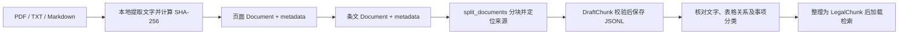

# 新文档自动分块

`chunk-document` 使用 LangChain 的 `langchain-text-splitters` 组件，把新文件转换成带来源位置的候选 chunk。支持含文字的 PDF、UTF-8 TXT 和 Markdown。整个过程在本机执行，不读取 `.env`，不调用 DeepSeek，不需要 API Key。

若需要“上传文件 → 自动分块 → embedding → Chroma 入库”，请使用 [上传知识库接口](knowledge-upload.md)。它复用本页的分块组件，完成同名检查、持久化任务和向量入库，ready 资料随即参与统一问答。日常上传无需运行本页的草稿命令。

## 使用方法

在项目根目录激活 `.venv`，安装一次依赖：

```bash
python -m pip install -e ".[dev,ingest]" -c constraints.txt
```

对现有 PDF 生成候选资料：

```bash
python -m transport_law chunk-document data/raw/P020250918567517504506.pdf \
  --output data/staging/new_document_chunks.jsonl \
  --document-id hubei-discretion-upload \
  --title "湖北省交通运输常用行政处罚自由裁量基准" \
  --chunk-size 800 \
  --chunk-overlap 120
```

换用新的文件路径就能处理新文档，例如：

```bash
python -m transport_law chunk-document data/raw/new_law.txt \
  --output data/staging/new_law_chunks.jsonl \
  --document-id new-law --title "新法规的正式名称"
```

以上 TXT 文件需要自行放入；`.md` 用法相同。不支持 Word、图片或网页直接导入。输出文件已存在时拒绝覆盖，应使用新的输出路径。没有目录监视功能。日常补充资料可直接使用网页的“上传资料”入口。

| 参数 | 含义 |
| --- | --- |
| `--chunk-size` | 每块最多多少个 Python 字符，默认 800；不是 token 数量 |
| `--chunk-overlap` | 同一条文内部相邻块的目标重叠字符数，默认 120，必须小于 chunk size |
| `--document-id` | 可选，人工指定文档身份；同一法规的不同版本可沿用它。省略时从文件内容校验值生成 |
| `--title` | 可选，文档标题；省略时用文件名，不从模型猜测正式名称 |
| `--output` | 必填，候选 JSONL 的保存位置，建议放在已被 Git 忽略的 `data/staging/` |

## 实际分块过程



先识别行首的“第一条”“第二章”“第三节”及 Markdown 标题，保留条文或章节标签为 `heading`。这只是结构启发式：引用的条号如果恰好位于行首，也可能被识别为新边界；自动换行、页眉页脚和 PDF 阅读顺序都会影响结果。

每个结构段独立交给 `RecursiveCharacterTextSplitter`。长度不超过上限的段落保持完整，过长内容优先沿空行、换行、中文标点等边界递归拆分，最终可按字符切分。相邻法条之间不添加重叠；同一条文内部的重叠是目标值，遇到自然段边界可能更少或为零。长条文的后续块通过 `heading` 保留条号，`text` 不额外插入虚构原文。

相邻的有文字 PDF 页以两个换行连接，因此条文可以跨页，来源位置同时记录各页。遇到无文字页就中断连接，并把页码列入 `needs_ocr_pages`。空白页也可能被列入，应先检查原件；本程序不执行 OCR。整份文件没有可提取文字时返回错误，不写空的候选文件。

## Document 与 metadata 的传递

`ingest.load_documents()` 是自动分块的加载入口，输出 LangChain `Document` 列表：PDF 每页一个，TXT/MD 每个文件一个。空白页也保留到分块阶段，以识别需要 OCR 的位置。底层仍复用原来的提取器，独立的 `extract-pdf` 命令不需要安装 LangChain。

每个页面的正文在 `page_content` 中，文档身份、内容版本、标题、文件名、SHA-256、格式、物理页码和审核状态从加载时就放入 `metadata`。条文整理和 `split_documents()` 继续传递这些信息。批量传入多份资料时，只拼接同一文档、同一版本且页码连续的 PDF 页面。

分块后需要重新计算 `source.locations`，不能把整页或整篇的页码范围直接当成每个 chunk 的精确出处。`start_index` 在 LangChain 中相对于传入的条文段，代码将它换算成各个 PDF 页内的位置；中间使用的偏移和页范围会从最终 metadata 中移除。每个 chunk 的 `Document.id` 沿用原有内容与位置计算规则。

```python
from pathlib import Path
from transport_law.ingest import load_documents
from transport_law.chunking import ChunkingOptions, DraftChunk, split_legal_documents

pages = load_documents(Path("data/raw/new_law.txt"), document_id="new-law")
documents = split_legal_documents(pages, ChunkingOptions())

# 正式保存前校验项目字段；from_document 不会改变原始 Document。
drafts = [DraftChunk.from_document(doc) for doc in documents]

# 已保存的草稿也能转换回 Document，便于后续组件使用。
document = drafts[0].to_document()
```

内部传递改用 `Document`，落盘的 `DraftChunk` JSONL 格式保持一致。`Document` 本身不自动持久化、建立检索索引或补齐法规效力信息。业务字段仍由 `DraftChunk` 校验；要新增可持久化的 metadata 字段，也需要明确其业务结构。

## 什么时候分块，重启会做什么

已经登记、清洗并按法条/表项整理的整批资料可以使用下文的 [批量处理入口](#批量处理已整理资料)。它仍然显式执行，不会随服务启动触发。

离线草稿调用链是 `chunk-document → load_documents → split_legal_documents → DraftChunk 校验 → 写入候选 JSONL`，整个命令执行期间完成分块。

| 操作 | 当前是否会执行 chunking |
| --- | --- |
| 运行 `chunk-document` | 会，处理指定的新文件 |
| 通过上传 API 接收新文件 | 会，后台分块后生成向量，写入独立上传库 |
| 启动或重启 `serve`，包括开发模式自动重启 | 不会，只加载正式条目；查询使用已有向量索引 |
| 用户检索或问答 | 不会，检索已加载的片段 |
| 把文件复制进 `data/raw/` | 不会，没有目录监视器 |
| 修改切分参数后重启服务 | 不会，需明确重新运行分块命令 |
| 对同一文件指定新的输出路径，再运行命令 | 会重新处理，目前未实现处理结果缓存 |
| 重试已成功切分的上传任务 | 不会重新分块，复用已保存结果；只补生成缺失向量 |

服务启动的 `build_runtime()` 加载已整理条目，不扫描原始文件或待审核区。查询计算 BM25 统计并读取已有向量，不重新切分原文或生成文档向量；候选 JSONL 也不会自动发布到正式知识库。

命令行输出防覆盖和稳定 ID 不等于导入去重：已存在的输出路径会报错，同一文件换输出路径仍会重新分块。上传接口另有文件名唯一约束和任务结果复用。已保存的旧 chunk 不会因修改分块代码而自动变化。

## 候选 chunk 保存什么

每行一个 `DraftChunk`，由 `src/transport_law/chunking.py` 定义：

| 字段 | 说明 |
| --- | --- |
| `id` | `AUTO-…`，由文件内容、文档身份、切分参数及来源位置生成；相同输入重复执行得到相同 ID |
| `document_id` / `version_id` | 文档身份 / 从文件 SHA-256 派生的版本身份，不代表施行日期 |
| `title` / `heading` | 文档标题 / 识别到的条文或章节标签；无法识别时 heading 为 null |
| `text` | 提取文本的片段，保留空白和标点；PDF 提取文本本身仍可能存在顺序问题 |
| `source.file` / `source.sha256` | 原文件名 / 完整文件校验值 |
| `source.format` | pdf、txt 或 md |
| `source.locations` | 此块涉及的每一页及其字符范围；多页片段有多个位置 |
| `chunking` | 策略版本、chunk size 和 overlap 参数 |
| `review_status` | 固定为 `needs_review`，表示需要人工核对 |

位置中的 `pdf_page` 从 1 开始；TXT/MD 没有物理页码，填 null。`start_index` 从 0 开始，`end_index` 不包含在范围内，PDF 位置相对于该页 `pypdf` 提取的字符串。文本文件位置相对于去掉 UTF-8 BOM 后的字符串。这些都是字符位置，不是 PDF 文件的字节位置，也不是页面坐标。

改变文档内容或切分参数可能产生新 ID。ID 稳定性用于同一策略版本的复现，不承诺不同版本的解析库总能生成相同文本；已验证依赖版本记录在 `constraints.txt`。

## 如何进入已整理法规库

自动分块保留文本与位置；正式法规收录还需核实来源、版本、条文边界和业务字段。上传资料则可自动进入独立上传库，并保持待核验状态。

1. 对照原件核对候选的文字、页码、条文边界，去掉页眉页脚、目录及重复内容。
2. 裁量表按同一事项整理，保留条件与结果对应，必要时合并多个候选块。一张表被切成若干块不代表每块都是完整裁量规则。
3. 补充或核实事项 ID、依据类别、适用地域、领域、官方来源和核验说明，把通过文字核对的内容整理为 `schemas.py` 的 `LegalChunk`。业务分类和法律效力不由文本切分器推断。
4. 正式 `Source` 区分 PDF 页码和网页官方链接、条文位置；TXT/MD 草稿不自动判定其法源类型，跨页候选也需按实际来源适配正式结构，不能填造 PDF 页码。候选 JSONL 不可直接替换 `LAW_DATA_PATH`。
5. 为正式条目补充检索别名与回归题，运行 `validate-data`、`evaluate`，重启服务加载资料。

这一步仍需人工或后续专用导入器，当前没有把任意草稿自动发布为已整理法规的命令。上传 API 可自动进入独立上传库，但不会替代以上核对与正式收录过程。自动分块输出与正式 `LegalChunk` 使用不同结构，误把草稿当知识库加载时会校验失败。

## 适用边界

普通法规正文适合“按条文优先，长条文再拆分”。多栏 PDF、跨页裁量表、扫描件需要进一步处理。当前不会还原合并单元格、自动关联处罚档次、识别法规效力、推断适用地区或生成确定的罚款数额。

LangChain 分块组件的原理和参数见[官方递归分块文档](https://docs.langchain.com/oss/python/integrations/splitters/recursive_text_splitter)。本项目用 LangChain 执行本地分块，业务问答固定使用 [混合检索](hybrid-retrieval.md)。

## 批量处理已整理资料

官网 HTML、修改决定合并文本、PDF 表格整理稿已经通过 `build_legal_corpus.py` 登记和清洗时，可统一处理当前知识库中的全部记录：

```bash
python scripts/build_legal_corpus.py --check
python scripts/chunk_legal_corpus.py \
  --output-dir data/staging/next_document_batch \
  --chunk-size 800 --chunk-overlap 120
```

默认输入为 `data/processed/legal_chunks.jsonl`；可用 `--corpus` 指定另一份符合 `LegalChunk` 结构的资料。已有输出目录会被拒绝覆盖。该入口处理的是已经整理的正文，不扫描尚未登记的原始文件；新 PDF/TXT/MD 可先使用 `chunk-document`。

程序先检查主来源与修改依据文件的 SHA-256，再把每个父条目正文固化为一个 UTF-8 TXT，通过 `load_documents → split_legal_documents` 处理。各父条文和裁量表项独立分块，避免不同事项混在一起；较短条文保持一块，过长正文才继续拆分。子块 ID 同时包含父条目身份，重复文字不会导致不同法条混用一个 ID。

| 批次中的文件 | 用途 |
| --- | --- |
| `langchain_documents.jsonl` | 全部标准 LangChain Document，含 `id`、`page_content`、`metadata`，可供后续向量化读取 |
| `draft_chunks.jsonl` | 与原 `DraftChunk` 格式兼容的候选记录 |
| `documents/` | 按来源文档与版本拆开的 Document JSONL |
| `inputs/` | 实际送入分块器的父条目正文，用于精确回查字符位置 |
| `manifest.json` | 每份文档的输入/输出数量、分块参数、依赖版本、校验结果与输出哈希 |

`metadata.source.locations` 指向本批次 `inputs/` 文件内的字符位置，**不是原 PDF 的页内位置**。真正的原始出处、官方链接、PDF 页码、条号、核验状态、修改决定及检索业务字段完整保存在 `metadata.provenance` 中，对应原 `LegalChunk` 除正文以外的字段。通过 `metadata.provenance.id` 可以关联原父条目；需要完整原文时读取对应 `inputs/` 文件或正式父记录。

全量 Document 增加了 `provenance` 元数据；配套 `draft_chunks.jsonl` 保留严格的原草稿结构。不能把这两份输出直接替换正式 `LAW_DATA_PATH`。当前批量处理不修改正式知识库、不建立向量索引，也不扩大原 PDF 已整理内容的范围。

`index-vectors` 可对完整 `langchain_documents.jsonl` 预检并建立向量索引，执行前对照当前正式父法条校验文本及出处。配置和步骤见 [向量检索说明](vector-retrieval.md)，历史批次规模见 [验证记录](validation.md)。
