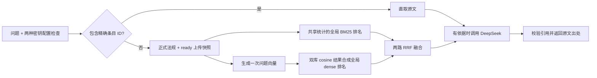

# 统一在线问答中的 BM25 + 向量 + RRF

产品通过网页、CLI `ask` 和 `POST /api/v1/ask` 提供一条固定在线问答链。`UnifiedRetriever` 联合正式法规和已完成入库的上传资料，不提供独立检索页面、检索 API 或离线问答模式。百炼 `text-embedding-v4` 与 Chroma 保存的文档向量继续复用，无需因入口调整重新分块。

## 当前查询如何执行



普通问题在全部可检索条目中召回，无需匹配人工事项别名。明确的法规名称、条号和表项仍约束候选；指定不存在的条号可返回空。精确条目 ID 可以直接获取条目，跳过 embedding 和 RRF，但入口仍要求百炼与 DeepSeek 两种密钥配置，有命中后仍调用 DeepSeek，不构成离线服务。

每次请求取得一次 ready 上传快照，并与可检索的正式法规组成同一语料集合。BM25 在这个集合上统一计算文档频率、平均长度等统计，得到一路全局关键词排名，而不是分别计算两库 BM25 分数后直接混排。

语义分支为问题生成一次向量，供正式库和上传库复用。两库使用相同 embedding 模型、维度、输入规范和 cosine 度量；各库查询结果按父条目去重后，依据同一相似度尺度排序成一路全局 dense 排名。随后才把全局 BM25 与全局 dense 两路融合，不叠加两份独立 RRF 结果。

两路并行执行，默认各取最多 50 个候选，融合后默认保留 5 条。向量子块回填正式父法条；上传资料按片段 ID 参与排名，不把整份上传文件误当成一个法条。新上传任务变为 `ready` 后，下次请求即可见，无需重启或重算已有文档向量。

## 排名与边界

BM25 分数与 cosine 相似度量纲不同，RRF 只使用这两路的名次，默认等权：

```text
RRF(条目) = 1 / (60 + 全局 BM25 排名) + 1 / (60 + 全局 dense 排名)
```

排名从 1 开始，没有进入某路候选窗口时该路贡献为 0。同一条目在每路只占一个名次；分数相同按 ID 稳定排序。`60` 是平滑常数，不是候选数量或最终返回数量。内部 `SearchHit.retrieval` 保存两路排名及原始分数，供维护诊断；按精确 ID 直取的结果不经过 RRF，相关字段为空。

RRF 分数不是相关概率、法律置信度或问答正确率。当前没有经过业务标定的向量拒答阈值；全库召回可能返回不够支持回答的条目，由在线问答链按原文说明资料不足。引用真实且来自本次检索，也不能单独证明解释正确、法规有效或个案适用。

## 使用与配置

先按 [README](../README.md) 配置两种密钥并准备正式法规索引，再使用统一入口：

```bash
python -m transport_law vector-status
python -m transport_law ask "在湖北普通公路上未经许可挖沟，应查哪些依据？"
python -m transport_law serve --reload
```

`ask` 不接受切换后端的 `--backend` 参数。在线业务运行时固定 hybrid；以下是服务端配置，前端不向使用者展示：

```dotenv
HYBRID_CANDIDATE_K=50
HYBRID_RRF_K=60
```

`HYBRID_CANDIDATE_K` 范围为 10–200，`HYBRID_RRF_K` 为 1–1000。问答 API 保留 1–10 的可选 `top_k`，网页只发送 `question`。修改配置不能让在线业务绕过密钥检查或退回 BM25 回答。

服务启动加载已整理条目；普通查询需要时再打开和校验向量索引。未建库时页面可启动，提问会明确报告索引问题。缺失、不完整、语料或模型不匹配的索引，以及百炼查询失败，都不会悄悄降级为单路问答。无候选时不调用回答模型；精确 ID 直取可省略打开向量索引和查询向量的步骤。

上传管理仍使用 `/api/v1/knowledge/documents` 的上传、列表、状态和重试接口。ready 上传资料自动进入统一 `/api/v1/ask`；来源读取统一使用 `/api/v1/articles/{chunk_id}` 和 `/api/v1/documents/{document_id}?version_id=...`。上传文档的全文范围标为 `uploaded_document`，不会自动发布为正式法规，见 [上传知识库说明](knowledge-upload.md)。

## 维护评测与当前问答的区别

```bash
python -m transport_law evaluate --backend bm25
python -m transport_law evaluate --backend chroma --dataset evals/official_retrieval.jsonl
python -m transport_law evaluate --backend hybrid --dataset evals/traffic_police_retrieval.jsonl
```

这些命令分别运行正式法规库的 `BM25Retriever`、`ChromaRetriever` 和 `HybridRetriever`，共用全库候选与法规定位约束。它们不包含 ready 上传快照或 DeepSeek 回答；Chroma 和 hybrid 评测会调用百炼。产品的 `UnifiedRetriever` 则在双库上计算全局排名。

批量对照可复用问题向量：

```bash
python scripts/compare_retrieval.py --output data/local/validation/retrieval_comparison.json
```

脚本不重建文档索引；报告不保存密钥或向量数值，已有输出不会被覆盖。默认比较三组题集，可重复传入 `--dataset` 指定数据集。共享查询向量会影响耗时，报告不能直接用于比较在线延迟。

早期题集中的范围外空结果预期来自人工事项门控。移除门控后，全库检索可能返回候选，由问答链判断资料是否足以回答；应分别评估召回完整性和最终拒答，不能修改预期 ID 来掩盖退化。旧算法对照留在 [历史验证记录](unified-validation.md#早期实现的对照记录)，历史通过率不适用于当前候选范围。

当前产品评测还需覆盖口语问题、正式与上传资料竞争、精确定位和资料不足拒答，并核对回答与原文。固定题集的检索通过率不能代替问答正确率。
