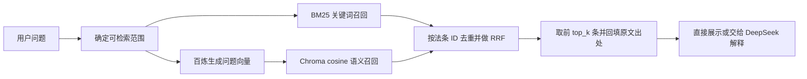

# BM25 + 向量 + RRF 混合检索

已实现 `hybrid` 检索模式，复用现有百炼 `text-embedding-v4` 和 Chroma 持久化向量。切换检索模式无需重新分块或生成文档向量。

## 查询如何执行



两路并行执行，各自最多取 50 个候选，最后默认返回 5 条。BM25 擅长词语、法规名称和条号匹配；向量模型把问题转换为与文档相同的 2048 维表示，Chroma 按 cosine 距离查找相近内容。问题使用 `text_type=query` 与查询指令，文档使用 `text_type=document`，沿用已有输入规范。

BM25 原始分数与 cosine 相似度的量纲不同。RRF 只使用各自的名次，默认等权融合：

```text
RRF(法条) = 1 / (60 + BM25 排名) + 1 / (60 + 向量排名)
```

排名从 1 开始；未进入某一路候选窗口时，该路贡献为 0。两路同时靠前的法条通常会排得更高。同一父法条的多个子块先合并，只计算一次排名，长法条不会因为切成更多块而额外加分。分数相同按 ID 稳定排序。`60` 是平滑常数，与候选数量和最终条数是三个不同参数，依据 [Microsoft RRF 说明](https://learn.microsoft.com/en-us/azure/search/hybrid-search-ranking)。

`SearchHit.score` 在混合模式中是 RRF 分数，**不是相关概率、法律置信度或模型准确率**。新增的 `retrieval` 字段记录 `method`、`rrf_k`、`bm25_rank`、`dense_rank` 及两路原始分数；只在一路出现时，另一路字段为 `null`。按明确 ID 直接定位的结果不经过 RRF，`retrieval` 为 `null`。

## 使用方式

已有索引时，可以直接执行：

```bash
python -m transport_law vector-status
python -m transport_law retrieve "闯红灯扣几分？" --backend hybrid
python -m transport_law ask "公路挖沟有哪些依据？" --backend hybrid
python -m transport_law evaluate --dataset evals/traffic_police_retrieval.jsonl --backend hybrid
```

`retrieve` 和 `evaluate` 只调用百炼问题向量接口；`ask` 在命中依据后还会调用 DeepSeek。首次安装和文档入库见 [向量检索说明](vector-retrieval.md)。

在本地 `.env` 中设置并重启服务后，网页、法规检索 API 和问答会使用选中的模式：

```dotenv
RETRIEVAL_BACKEND=hybrid
HYBRID_CANDIDATE_K=50
HYBRID_RRF_K=60
```

`HYBRID_CANDIDATE_K` 范围为 10–200，`HYBRID_RRF_K` 为 1–1000，最终 `top_k` 仍为 1–10。`bm25`、`chroma`、`hybrid` 三种后端均保留；命令行 `--backend` 只覆盖当前命令，不改 `.env`。新环境默认仍是 BM25，原因见下方实测结果。

服务启动读取正式 JSONL、构建内存 BM25 统计并校验已有 Chroma 索引；不会重新分块或生成文档向量。一次普通混合查询只生成一次问题向量。缺失、未完成、语料/模型不匹配的索引会报错；百炼查询失败也会明确报错，不把单路结果标记为成功融合。需要离线检索时可以显式选择 `bm25`。

## 正式法规与上传资料的范围

正式法规入口 `/api/v1/retrieve`、`/api/v1/ask` 使用 `RETRIEVAL_BACKEND`。本版两路共用原有法规名消歧、条号和事项别名范围约束；不存在的条号以及没有候选的范围外问题不会发出向量请求。向量负责候选内的语义排序，**尚未实现不依赖事项别名的全库语义召回**。BM25 和向量都返回正式父法条，引用 ID、完整原文、官方 URL/PDF 页码及核验状态保持一致。

新上传资料入口 `/api/v1/knowledge/retrieve`、`/api/v1/knowledge/ask` 独立选择模式：

```dotenv
KNOWLEDGE_RETRIEVAL_BACKEND=hybrid
```

上传库默认保持原来的 `chroma`，也可以选择 `bm25`。上传片段尚没有人工整理的执法事项标签，所以两路都从全部 `ready` 片段中召回，不套用正式法规的事项别名过滤。每次请求取得一次已完成资料快照；新文档处理为 `ready` 后，下一次查询即可在 BM25 和向量两路中看到，无需重启。上传库 RRF 按片段 ID 合并，不把整份文件当成一个法条；失败或处理中任务的部分结果均不参与召回。

正式法规与上传库仍使用独立入口和 collection；本次没有将未经核验的上传片段自动发布为正式法规。上传库目前没有经过业务标定的相似度拒答阈值，RRF 本身也不提供“资料足够”的判断。上传与来源规则见 [上传知识库说明](knowledge-upload.md)。

## 2026-11-05 真实检索对照

使用既有 1,338 个向量、1,336 个父记录，在相同范围约束、`top_k=5` 下比较；未改变回归题、预期 ID 或融合默认参数来提高分数。70 条用例共 69 个不同问题，58 个需要生成问题向量，其余为明确 ID 或空候选。Chroma 与 hybrid 共用一次评测内存中的问题向量，无接口错误。

| 开发回归集 | BM25 | 纯向量 Chroma | 混合 RRF |
| --- | --- | --- | --- |
| 原事项 | 20/20 | 20/20 | 20/20 |
| 法规定位 | 20/20 | 20/20 | 20/20 |
| 公安交管 | 30/30 | 25/30 | 28/30 |
| 合计 | **70/70** | **65/70** | **68/70** |

交管组的正例平均 Recall@5：BM25 为 1.0000、Chroma 为 0.8782、RRF 为 0.9615。正例须全部预期依据进入前 5 条才算通过；负例须返回空。RRF 补回右转让行、酒后事故处理和红灯记分三题，但红灯碰撞、电动车逆行两题仍有预期条文未进入前 5 条。例如“闯红灯扣几分？”的预期记分条文在 BM25 排第 1、向量排第 34，融合后排第 4。

**因此正式法规默认仍保留 BM25，混合模式作为可选择、可评测的后端。** 这些是既有开发回归样例，不代表真实业务准确率；没有验证真实 DeepSeek 回答质量，也没有据此确认法规效力或具体案件适用。进一步优化应补充独立的口语问题评测，再评估候选范围、重排和融合参数，不能仅凭加入 RRF 就认定效果一定更好。

复现对照：

```bash
python scripts/compare_retrieval.py --output data/local/validation/hybrid_comparison.json
```

脚本会调用百炼，每个不同问题的向量在本次对照内共享；不调用 DeepSeek、不重建文档索引。报告不保存密钥或向量数值，已存在的输出文件不会被覆盖。默认比较三组回归，可用重复的 `--dataset` 指定其他数据集。由于使用共享查询向量，报告耗时不能直接用于比较三种后端的在线延迟。

初次完整报告为 Git 忽略的 `data/local/validation/hybrid_20261105.json`。修复英文 BM25 单词边界后，最终复核的原事项组出现一次 `embedding_unavailable` 网络错误；单线程复跑该 20 题组全部成功，其他两组无需补跑，最终三路指标与上表一致。原始记录保留在 `hybrid_20261105_final.json` 和 `hybrid_20261105_retrieval_retry.json`，合并验证记录为 `hybrid_20261105_verified.json`。

最终全套自动化测试 **223 项通过**，Ruff、格式检查、前端 JavaScript 语法检查和 `git diff --check` 通过。Chroma 依赖内部有 63 条既有配置弃用提示。真实 FastAPI TestClient 通过 hybrid 模式调用百炼，检索返回 200；逐条核对 RRF 公式、法条详情回填与来源一致，持久化向量数量仍为 1,338。未调用真实 DeepSeek，未启动或重启用户服务；API 记录为 `data/local/validation/api_hybrid_20261105.json`。

实现入口：`hybrid.py` 为并行召回与 RRF，`retrieval.py` 为 BM25，`vector_store.py` 为正式向量检索，`runtime.py` 选择后端，`knowledge.py` 接入上传资料。自动化验证覆盖排名融合、子块去重、候选窗口、并行执行、空范围短路、故障透传、来源回填、引用拦截和上传后即时可检索。
