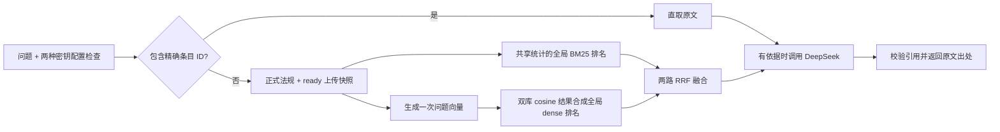

# 统一在线问答中的 BM25 + 向量 + RRF

产品通过网页、CLI `ask` 和 `POST /api/v1/ask` 提供一条固定在线问答链。`UnifiedRetriever` 联合正式法规和已完成入库的上传资料，不提供独立检索页面、检索 API 或离线问答模式。百炼 `text-embedding-v4` 与 Chroma 保存的文档向量继续复用，无需因入口调整重新分块。

## 当前查询如何执行



普通问题使用 `candidate_chunks(..., broad=True)`，不再要求命中人工事项别名才允许召回。明确的法规名称、条号和表项仍约束候选；指定不存在的条号可返回空。精确条目 ID 可以直接获取条目，跳过 embedding 和 RRF，但入口仍要求百炼与 DeepSeek 两种密钥配置，有命中后仍调用 DeepSeek，不构成离线服务。

每次请求取得一次 ready 上传快照，并与可检索的正式法规组成同一语料集合。BM25 在这个集合上统一计算文档频率、平均长度等统计，得到一路全局关键词排名，而不是分别计算两库 BM25 分数后直接混排。

语义分支为问题生成一次向量，供正式库和上传库复用。两库使用相同 embedding 模型、维度、输入规范和 cosine 度量；各库查询结果按父条目去重后，依据同一相似度尺度排序成一路全局 dense 排名。随后才把全局 BM25 与全局 dense 两路融合，不叠加两份独立 RRF 结果。

两路并行执行，默认各取最多 50 个候选，融合后默认保留 5 条。向量子块回填正式父法条；上传资料按片段 ID 参与排名，不把整份上传文件误当成一个法条。新上传任务变为 `ready` 后，下次请求即可见，无需重启或重算已有文档向量。

## 排名与边界

BM25 分数与 cosine 相似度量纲不同，RRF 只使用这两路的名次，默认等权：

```text
RRF(条目) = 1 / (60 + 全局 BM25 排名) + 1 / (60 + 全局 dense 排名)
```

排名从 1 开始，没有进入某路候选窗口时该路贡献为 0。同一条目在每路只占一个名次；分数相同按 ID 稳定排序。`60` 是平滑常数，不是候选数量或最终返回数量。内部 `SearchHit.retrieval` 保存两路排名及原始分数，供维护诊断；按精确 ID 直取的结果不经过 RRF，相关字段为空。

RRF 分数不是相关概率、法律置信度或问答正确率。当前没有经过业务标定的向量拒答阈值；全库召回可能返回不够支持回答的条目，由在线问答链按原文说明资料不足。引用真实且来自本次检索，也不能单独证明解释正确、法规有效或个案适用。

## 使用与配置

先按 [README](../README.md) 配置两种密钥并准备正式法规索引，再使用统一入口：

```bash
python -m transport_law vector-status
python -m transport_law ask "在湖北普通公路上未经许可挖沟，应查哪些依据？"
python -m transport_law serve --reload
```

`ask` 不接受切换后端的 `--backend` 参数。在线业务运行时固定 hybrid；以下是服务端配置，前端不向使用者展示：

```dotenv
RETRIEVAL_BACKEND=hybrid
KNOWLEDGE_RETRIEVAL_BACKEND=hybrid
HYBRID_CANDIDATE_K=50
HYBRID_RRF_K=60
```

`HYBRID_CANDIDATE_K` 范围为 10–200，`HYBRID_RRF_K` 为 1–1000。问答 API 保留 1–10 的可选 `top_k`，网页只发送 `question`。修改配置不能让在线业务绕过密钥检查或退回 BM25 回答。

服务启动加载已整理条目；普通查询需要时再打开和校验向量索引。未建库时页面可启动，提问会明确报告索引问题。缺失、不完整、语料或模型不匹配的索引，以及百炼查询失败，都不会悄悄降级为单路问答。无候选时不调用回答模型；精确 ID 直取可省略打开向量索引和查询向量的步骤。

上传管理仍使用 `/api/v1/knowledge/documents` 的上传、列表、状态和重试接口。ready 上传资料自动进入统一 `/api/v1/ask`；来源读取统一使用 `/api/v1/articles/{chunk_id}` 和 `/api/v1/documents/{document_id}?version_id=...`。上传文档的全文范围标为 `uploaded_document`，不会自动发布为正式法规，见 [上传知识库说明](knowledge-upload.md)。

## 维护评测与当前问答的区别

```bash
python -m transport_law evaluate --backend bm25
python -m transport_law evaluate --backend chroma --dataset evals/official_retrieval.jsonl
python -m transport_law evaluate --backend hybrid --dataset evals/traffic_police_retrieval.jsonl
```

这些命令比较正式法规库的既有检索器；其中 hybrid 使用旧受限候选 `HybridRetriever`，并不运行当前双库 `UnifiedRetriever`。维护评测保留算法选项，不改变用户问答链。Chroma 和 hybrid 评测调用百炼，不调用 DeepSeek。

要评估当前产品，需要另行覆盖未命中旧事项别名的口语问题、正式与上传资料竞争、精确定位、范围外问题及资料不足拒答，并核对真实在线回答和出处。既有固定题集可以作为维护基线，但不能把其通过率当作全库问答正确率。

## 2026-11-05 历史检索对照：受限候选 HybridRetriever

**以下结果属于旧的受限候选 `HybridRetriever` 及同范围 BM25 / Chroma 对照，不是本次 `broad=True`、双库全局排名的 `UnifiedRetriever` 正确率。** 当时只比较正式法规库，没有把 ready 上传文档加入全局 BM25 统计或 dense 排名。

使用既有 1,338 个向量、1,336 个父记录，在相同范围约束、`top_k=5` 下比较；未改变回归题、预期 ID 或融合默认参数来提高分数。70 条用例共 69 个不同问题，58 个需要生成问题向量，其余为明确 ID 或空候选。Chroma 与 hybrid 共用一次评测内存中的问题向量，无接口错误。

| 开发回归集 | BM25 | 纯向量 Chroma | 混合 RRF |
| --- | --- | --- | --- |
| 原事项 | 20/20 | 20/20 | 20/20 |
| 法规定位 | 20/20 | 20/20 | 20/20 |
| 公安交管 | 30/30 | 25/30 | 28/30 |
| 合计 | **70/70** | **65/70** | **68/70** |

交管组的正例平均 Recall@5：BM25 为 1.0000、Chroma 为 0.8782、RRF 为 0.9615。正例须全部预期依据进入前 5 条才算通过；负例须返回空。RRF 补回右转让行、酒后事故处理和红灯记分三题，但红灯碰撞、电动车逆行两题仍有预期条文未进入前 5 条。例如“闯红灯扣几分？”的预期记分条文在 BM25 排第 1、向量排第 34，融合后排第 4。

当时据此保留 BM25 为旧产品默认；当前产品已固定统一在线 hybrid 问答，该历史选择不再是当前使用方式。 这些是既有开发回归样例，不代表真实业务准确率；没有验证真实 DeepSeek 回答质量，也没有据此确认法规效力或具体案件适用。进一步优化应补充独立的口语问题评测，再评估候选范围、重排和融合参数，不能仅凭加入 RRF 就认定效果一定更好。

复现旧受限候选算法对照（不覆盖当前 `UnifiedRetriever`）：

```bash
python scripts/compare_retrieval.py --output data/local/validation/hybrid_comparison.json
```

脚本会调用百炼，每个不同问题的向量在本次对照内共享；不调用 DeepSeek、不重建文档索引。报告不保存密钥或向量数值，已存在的输出文件不会被覆盖。默认比较三组回归，可用重复的 `--dataset` 指定其他数据集。由于使用共享查询向量，报告耗时不能直接用于比较三种后端的在线延迟。

初次完整报告为 Git 忽略的 `data/local/validation/hybrid_20261105.json`。修复英文 BM25 单词边界后，最终复核的原事项组出现一次 `embedding_unavailable` 网络错误；单线程复跑该 20 题组全部成功，其他两组无需补跑，最终三路指标与上表一致。原始记录保留在 `hybrid_20261105_final.json` 和 `hybrid_20261105_retrieval_retry.json`，合并验证记录为 `hybrid_20261105_verified.json`。

当时全套自动化测试 **223 项通过**，Ruff、格式检查、前端 JavaScript 语法检查和 `git diff --check` 通过。Chroma 依赖内部有 63 条既有配置弃用提示。真实 FastAPI TestClient 通过 hybrid 模式调用百炼，检索返回 200；逐条核对 RRF 公式、法条详情回填与来源一致，持久化向量数量仍为 1,338。未调用真实 DeepSeek，未启动或重启用户服务；API 记录为 `data/local/validation/api_hybrid_20261105.json`。

当前实现入口：`online.py` 装配双库快照、全局 BM25/dense 排名及在线密钥检查，`hybrid.py` 复用 RRF 融合并保留旧 `HybridRetriever` 供维护评测，`vector_store.py` 与 `knowledge.py` 分别读取两座持久向量库，`runtime.py` 固定在线业务配置。当前全库问答的召回与拒答质量需要独立评估，不能引用上表作为验证结论。
