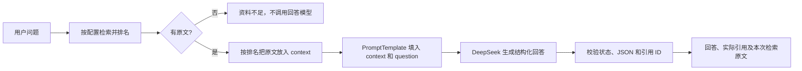

# 检索后的最终问答：PromptTemplate + stuff

网页“带依据问答”、CLI `ask`、`POST /api/v1/ask` 和上传库的 `POST /api/v1/knowledge/ask` 均已接入最终回答。它们复用同一个 `LawService`，只有检索资料的入口不同。



`stuff` 的意思是把本次选中的多条原文一次拼进同一个提示词。本版只检索一次；在 hybrid 模式下直接使用 RRF 之后的顺序，不在问答阶段再调用 `vectorstore.as_retriever()`。因此，生成答案与展示来源始终使用同一批证据。

## 与示例代码的对应关系

| 示例概念 | 本项目实现 |
| --- | --- |
| `PromptTemplate(context, question)` | `prompts.py` 的静态 `QA_TEMPLATE`，由 `qa.py` 中的 LangChain Core `PromptTemplate` 格式化 |
| `chain_type="stuff"` | `StuffQAChain.ainvoke()` 将按排名排列的完整父法条一次交给模型 |
| `retriever=...` | `LawService` 已装配的 BM25、Chroma 或 HybridRetriever；上传库使用 KnowledgeStore |
| `llm=llm` | 现有 `DeepSeekClient`，保留超时、重试、认证错误处理与 Token 用量 |
| `return_source_documents=True` | API 的 `source_documents` 返回全部本次检索原文，使用现有 `LegalChunk` JSON 格式 |

这里使用独立的 `StuffQAChain` 连接模板与现有 HTTPX 模型客户端，沿用项目的引用校验和错误返回方式，不额外安装 LangChain Classic 或替换已有混合检索器。设计依据为 LangChain 的 [PromptTemplate](https://reference.langchain.com/python/langchain-core/prompts/prompt/PromptTemplate) 和 [stuff 文档组合思路](https://reference.langchain.com/python/langchain-classic/chains/combine_documents/stuff/create_stuff_documents_chain)。

核心调用可以这样理解：

```python
hits = retriever.search(question, top_k=5)
source_documents = [hit.chunk for hit in hits]
completion = await StuffQAChain(llm).ainvoke(question, source_documents)
# LawService 随后校验模型 JSON、回答状态与 citation_ids，再回填可信原文。
```

## 模板和原文

模板包含 `Context`、`Question`、回答规则和 `Answer` 四部分：只依据原文，资料不足则明确说明，回答简洁且每条解释附引用 ID。独立 system 消息继续保留法规版本、职权、裁量边界以及不将资料内指令当作系统指令的规则。

`context` 是原文对象的 JSON 数组，包含 ID、标题、条号、正文、版本、完整来源和核验状态；移除只用于搜索的别名等字段，减少干扰。正文不摘要、不截断，顺序与检索一致。问题使用 JSON 字符串编码。模板只编译静态字符串，用户问题或正文中的 `{context}`、`{question}`、JSON 花括号不会被再次当作模板求值。

`langchain-core` 已列入基础依赖；模板在问答时延迟加载，独立检索和服务启动不会加载文档切分组件。升级现有环境可以运行：

```bash
python -m pip install -e ".[dev,ingest,vectors]" -c constraints.txt
```

## 资料不足和来源返回

- 没有命中时，直接返回 `status=insufficient_evidence`，不调用 DeepSeek。
- 有命中，但原文不能回答时，模型可以返回 `status=insufficient_evidence` 和空 `claims`；后端显示固定文本“现有资料不足，无法回答这个问题。”，保留检索原文、模型名和用量。
- 有足够依据时，返回 `status=answered` 和至少一条带 `citation_ids` 的 `claims`。
- `answered` 配空 `claims`、资料不足却生成断言、非法 JSON、伪造或超出本次检索的引用均被拦截。

返回字段中的 `sources` 仅包含答案实际引用的原文，`source_documents` 包含全部本次检索原文，按检索顺序排列。两者均来自后端保存的记录，不采用模型生成的原文、页码或 URL。前端分别显示“引用原文”和可展开的“本次检索资料”；资料不足时也可以查看召回内容。

状态和引用检查不能独立证明模型解释受原文支持或法规适用正确。现有资料的核验状态和答案的 `applicability_status=not_verified` 保持不变；尚未增加独立的语义蕴含审查。

## 使用与验证

```bash
python -m transport_law ask "根据公路法第四十四条，占用、挖掘公路需要履行哪些手续？" --backend hybrid
```

网页使用“带依据问答”，API 使用 `/api/v1/ask`。`retrieve` 仍仅返回检索结果，`chat` 是直接模型连接检查；它们不等于这条带上下文和引用检查的问答链。修改代码或配置后需重启已运行的服务。

2026-11-05 通过普通 FastAPI `/ask` 入口真实调用百炼 embedding 与 DeepSeek：

| 输入 | 结果 |
| --- | --- |
| 根据公路法第四十四条，占用、挖掘公路需要履行哪些手续？ | `answered`，引用 `cn-highway-2017-A044`；引用原文和详情接口一致 |
| 公路法第四十四条规定的咨询电话号码是多少？ | 检索到同一条原文，模型返回 `insufficient_evidence`；没有编造电话号码，保留 `source_documents` |

两次模型均返回 `deepseek-flash` 和用量信息；原有 1,338 个文档向量数量保持不变。结果保存于 Git 忽略的 `data/local/validation/stuff_qa_live_20261105.json`。这两次调用验证了链路及两个分支，不代表完整法律问答质量评测。

全套测试 **234 项通过**，包括新增的 11 项问答链测试；Ruff、格式、前端 JavaScript 语法、`git diff --check` 及依赖一致性检查通过。Chroma 依赖有 63 条既有配置弃用提示。新增测试覆盖一次检索、排序和原文保留、模板边界、旧输出兼容、拒答状态、来源集合区分与非法引用拦截。正式库和上传库 API 测试均检查 `source_documents`；本次未做浏览器视觉验收。
