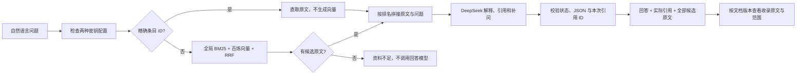

# 统一在线问答链

网页上的自然语言输入、CLI `ask` 和 `POST /api/v1/ask` 使用同一条问答链。用户不选择法规检索、问答或裁量检查，也不选择 BM25 / Chroma 模式。业务服务固定使用 hybrid 检索和 DeepSeek，正式法规及 `ready` 上传资料共同参与检索。



普通语义检索由百炼生成问题向量，DeepSeek 基于检索原文回答。精确条目 ID 直取会跳过 embedding 和 RRF，但 `LawService` 仍先检查百炼与 DeepSeek 两种密钥配置，并在命中后调用在线回答模型；这不是离线问答入口。缺少密钥、索引失败或上游调用失败会报错，不切换为离线回答。无候选时不调用 DeepSeek，但整个业务入口仍属于在线检索流程。

## 检索与原文拼接

`stuff` 表示把本次选中的多条原文一次放入同一个提示词。问答只检索一次，普通查询使用 RRF 后的最终顺序，精确 ID 查询使用直取结果；不会在生成阶段另调一次检索器，回答和出处始终对应同一批证据。

| 组件 | 实现 |
| --- | --- |
| 检索 | `UnifiedRetriever` 以双库条目共享 BM25 统计，把双库向量结果合为全局 dense 排名，再执行 RRF；精确 ID 可直取 |
| 模板 | `prompts.py` 的静态 `QA_TEMPLATE`，使用 Python 字符串格式化 |
| 原文拼接 | `build_qa_messages()` 将排名后的完整父条目编码为上下文消息 |
| 模型 | `DeepSeekClient`，保留 HTTPX 超时、重试、认证错误及用量处理 |
| 可信来源 | `LawService` 校验引用后，从本次检索条目回填，不使用模型编写的出处 |

普通问题在全部可检索条目中召回，明确的法规名称与条号约束范围。两座向量库共享同一次问题 embedding，使用一致的模型、维度和 cosine 度量。维护命令 `evaluate --backend hybrid` 只比较正式法规库的召回；它不覆盖上传资料合并及模型回答，得分不能视为业务问答正确率。

上下文对象包含 ID、标题、条号、正文、版本和来源核验状态，不包括只供搜索的别名等字段。原文不摘要、不截断，顺序与检索一致；这里的“完整父条目”不意味着其所属文档已收录整部法规。

用户问题使用 JSON 字符串编码。格式化只处理静态模板，原文或问题中的 `{context}`、`{question}` 和 JSON 花括号不会再次求值。资料内指令作为引用内容处理，不能改变系统回答规则。

## 裁量问题和补充信息

同一条问答链处理“有哪些规定”“这种情况怎么办”“处罚还要核实什么”等问题。提示词要求从已收录材料解释依据、把缺失事实作为补问，并说明地域、职权、道路类型、规则版本和条件边界；不把没有提供的事实自动补齐，不直接选档或计算确定罚款。

`follow_up_questions` 用于返回需要补充的信息。没有多轮记忆；用户必须将原有背景和补充情况放在同一个问题中重新发送。前端的“补充情况”按钮只返回输入区，不把前次回答作为隐藏上下文再次提交。

## 状态、来源和原文阅读

- 无命中：返回 `status=insufficient_evidence`，不调用回答模型。
- 有命中但不足以回答：模型可返回 `insufficient_evidence` 与空 `claims`；服务保留候选原文、实际模型名和用量。
- 有足够依据：返回 `status=answered` 和至少一条带 `citation_ids` 的解释。
- 已回答却无解释、资料不足却生成断言、非法 JSON、伪造或超出本次检索的引用都会被拦截。

`sources` 只包含回答实际使用的依据；`source_documents` 包含本次全部候选。两者来自后端保存的原文，模型不能伪造正文、版本、页码或 URL。页面把实际引用和其余相关资料分开展示，资料不足时也能阅读已有候选。

引用详情使用 `GET /api/v1/articles/{chunk_id}`。查看整份收录材料使用 `GET /api/v1/documents/{document_id}?version_id=...`，文档响应包括：

```text
document_id, version_id, title, coverage, coverage_note, articles[]
```

`coverage` 有四种值：`full_text` 为整部法规正文，`selected_sections` 为选定章节，`excerpts` 为节选，`uploaded_document` 为上传资料内容。前端默认按钮为“查看已收录原文”；只有文档明确标记 `full_text`，才把阅读内容标为“整部法规”。其余内容须同时展示范围说明，不能统称法规全文。`articles` 只返回该文档、该版本已经保存的原文，不由模型补写。

PDF 显示真实物理页码及可用的印刷页码；官网正文显示官方链接与条文位置；合并整理时保留修改决定等补充来源。覆盖范围、来源核验和 `applicability_status=not_verified` 是不同维度，全文展示不会改变法律适用状态。

## 使用与验证

```bash
python -m pip install -e ".[dev,ingest,vectors]" -c constraints.txt
python -m transport_law ask "根据公路法第四十四条，占用、挖掘公路需要履行哪些手续？"
python -m transport_law serve --reload
```

API 提交 `{"question": "你的问题"}` 至 `/api/v1/ask`，前端不暴露检索参数。上传文件的 list、status、retry 和提交接口仍用于管理，但上传资料的提问也通过统一 `/api/v1/ask`，不使用独立的上传库问答入口。修改代码、数据或配置后需重启服务。

维护人员可用 `evaluate --backend bm25|chroma|hybrid` 比较算法，不能用该选项切换用户问答到离线模式。只使用替身的单元与接口测试验证结构、错误分支和引用归属；实际在线链路需另行调用百炼及 DeepSeek，并记录返回状态、引用与原文一致性、模型名和用量。历史真实调用及回归结果见 [验证记录](validation.md)。

状态与引用检查不能证明每条解释受原文充分支持。当前没有独立的语义蕴含审查；法律效力、解释准确性和个案适用仍须结合出处复核。

历史自动化、真实在线样本及验证边界见 [统一入口验证记录](unified-validation.md)。
